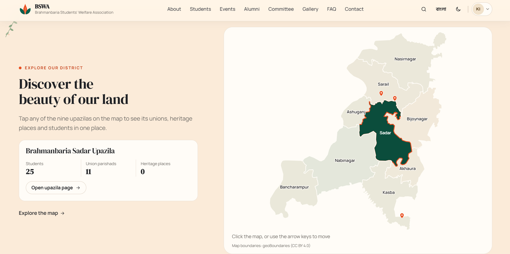
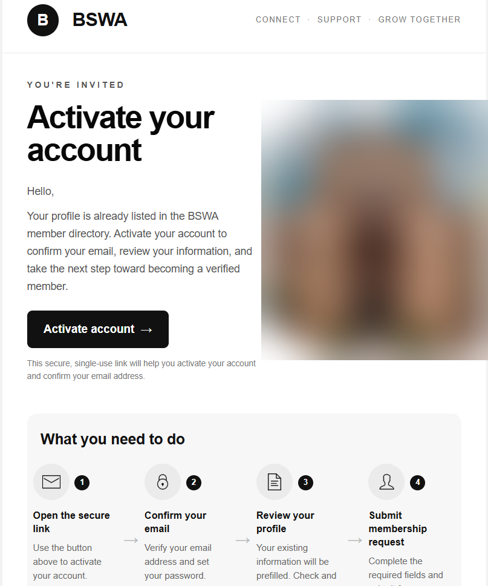
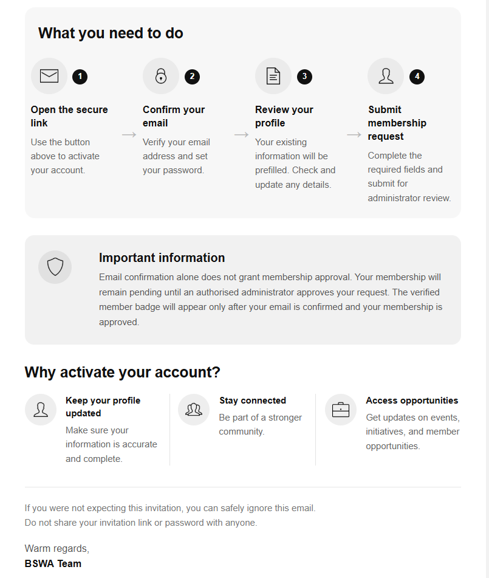
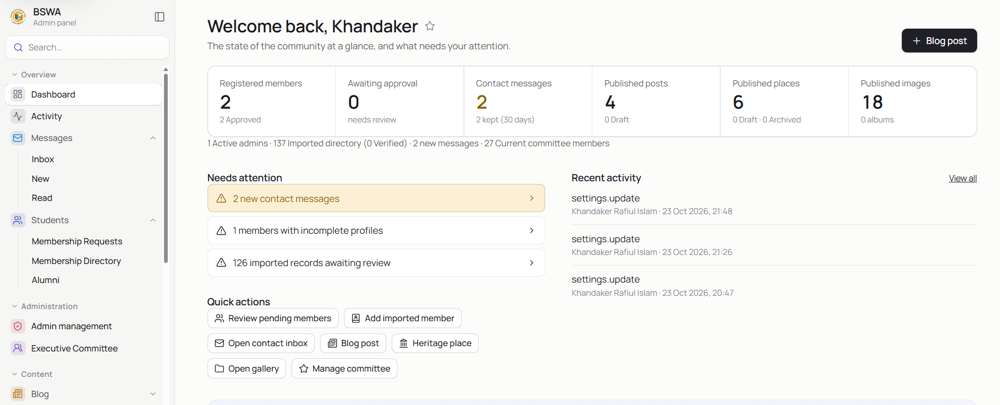
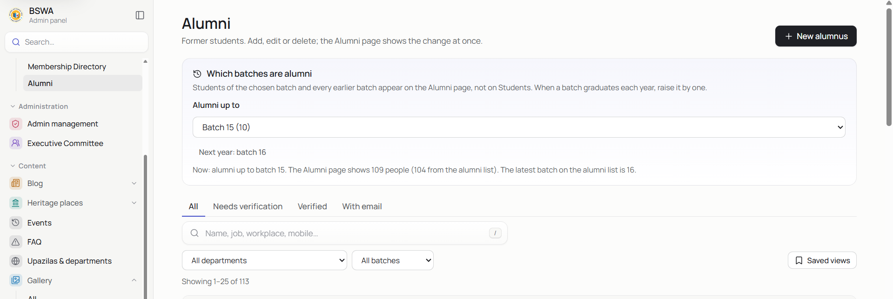
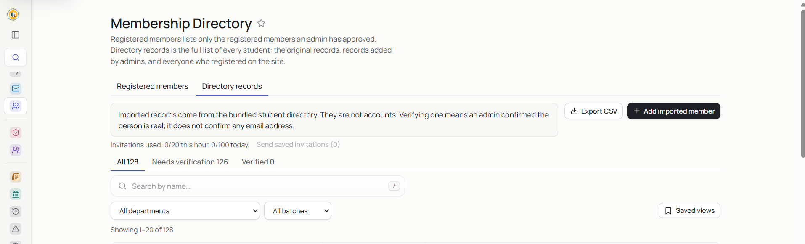
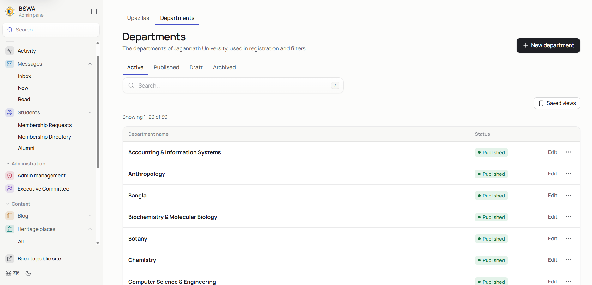

# BSWA: Brahmanbaria Students' Welfare Association

A community platform for students and alumni from Brahmanbaria at Jagannath University. It combines a public site (student and
alumni directory, district heritage and map, events, gallery, blog, executive committee) with a member area and an admin panel
for the committee.

- **Bilingual:** Bangla by default, English available; light and dark themes.
- **Real data only:** the directory, content and settings live in Supabase (PostgreSQL). Nothing on the public site is mocked.
- **Reviewed membership:** members sign up, verify their email and are approved by an admin before they get a profile.

<p align="center"></p>

> Full product requirements: [PROJECT_REQUIREMENTS.md](PROJECT_REQUIREMENTS.md)

## Contents

- [Features](#features)
- [Architecture](#architecture)
- [Repository layout](#repository-layout)
- [Getting started](#getting-started)
- [Configuration](#configuration)
- [Data management](#data-management)
- [Testing](#testing)
- [Deployment](#deployment)
- [Security](#security)
- [Documentation](#documentation)
- [Credits](#credits)
- [License](#license)

## Features

### Public site

Bangla by default, English one click away, light and dark themes, fully responsive.

- **Home, About and Heritage:** the district's story, its nine upazilas, heritage places and culture.
- **Students and Alumni:** searchable lists with department, batch and upazila filters. A saved "alumni up to batch" setting decides which batches appear on which page.
- **Events, Gallery, Blog, FAQ, Executive Committee and Contact:** read from the database; only published items are shown.
- **Accounts:** sign up, confirm the email address, wait for admin approval, then use a profile page. Strong-password rules with live guidance; password reset and automatic sign-in after email confirmation.

<table>
  <tr>
    <td width="50%"><br><sub><b>Explore Brahmanbaria.</b> Heritage, culture and the nine upazilas.</sub></td>
    <td width="50%"><br><sub><b>Interactive map.</b> Select an upazila to see its students, union parishads and heritage places.</sub></td>
  </tr>
  <tr>
    <td colspan="2"><br><sub><b>Student community.</b> Members of every department and batch, together.</sub></td>
  </tr>
</table>

### Branded emails

Three responsive HTML templates share one design and are pasted into Supabase (Authentication → Email Templates). The sources are in [docs/email-templates/](docs/email-templates/).

| Email | When it is sent | What it does |
| --- | --- | --- |
| Invitation | An admin sends an activation link to a directory or alumni record. | Explains the four steps (open the link, confirm the email, review the prefilled profile, submit the membership request) and states that email confirmation alone does not grant membership. |
| Email verification | Someone signs up. | Confirms the address and signs the person in automatically, then opens the site. |
| Password reset | Someone asks for a reset. | Single-use link to choose a new password under the strong-password rules, then signs the person in. |

All links are single use and point at the site's own address (see the Supabase URL configuration in [docs/deployment.md](docs/deployment.md)).

<table>
  <tr>
    <td width="50%"></td>
    <td width="50%"></td>
  </tr>
</table>

### Admin panel (`/admin`)

Every change is saved to Supabase and appears on the public site immediately. All admins have the same abilities; there is no limit on how many there can be, and the last admin cannot leave the role.

<p align="center"></p>

| Area | What admins can do |
| --- | --- |
| Dashboard | Member, request, message and content counts; a "needs attention" list; charts by batch, department and upazila; recent activity; quick actions. |
| Quick search | One search over every admin page and record. |
| Messages | Contact-form inbox: read, mark as read, delete. Messages are kept for 30 days. |
| Membership Requests | Approve or reject sign-ups, with complete and incomplete profile views. |
| Membership Directory | Registered members and directory records of the batches still studying. Add, edit, delete, export CSV; save an email on a record, send or resend the activation link, verify or unverify. |
| Alumni | Alumni records plus graduated students and members. The **Alumni up to batch** setting is saved in Supabase and both public pages follow it. Same email, invitation and verification steps as directory records. |
| Admin management | Find any member by any detail and promote them to admin (double confirmation). Remove a member (double confirmation). |
| Executive Committee | Terms, seats and photos; the published term appears on `/committee`. |
| Content | Blog, heritage places, events, FAQ, upazilas and departments, gallery albums and images: create, edit, publish, draft, archive, delete. |
| Activity | Audit trail of admin actions. |

<table>
  <tr>
    <td width="50%"><br><sub><b>Alumni.</b> One setting decides which batches count as alumni.</sub></td>
    <td width="50%"><br><sub><b>Membership Directory.</b> Registered members and directory records.</sub></td>
  </tr>
  <tr>
    <td colspan="2"><br><sub><b>Reference data.</b> Departments and upazilas, used in registration and filters.</sub></td>
  </tr>
</table>

## Architecture

```text
Browser ──► Cloudflare Pages (React + Vite, static files)
   │                │
   │                └──► Go API on Render ──► Supabase PostgreSQL (data, roles, settings)
   │                              └────────► Gmail SMTP (contact notification)
   └──► Supabase Auth (sign-up, sign-in, password reset, invitations; sends its emails through Gmail SMTP)
```

- **Frontend:** a static single-page app. It talks to the Go API for all data and to Supabase Auth for sign-in, using only the public (publishable) key.
- **Backend:** a Go service built on the standard library. It verifies Supabase access tokens, applies role checks, and reads and writes PostgreSQL. Directory records, published departments, upazilas, places and the alumni setting are cached in memory and reloaded after every admin change.
- **Database:** Supabase PostgreSQL with row level security; the public key cannot read any application table. Migrations run automatically when the API starts.
- **Email:** Supabase Auth sends sign-up, reset and invitation emails. The backend sends only the contact-form notification (Gmail SMTP).

## Repository layout

```text
backend/     Go API: handlers, stores (PostgreSQL and in-memory), migrations/, tests
frontend/    React + Vite app: src/pages, src/admin, src/components, src/lib, e2e/ (Playwright)
scripts/     Data builders for the directory and the upazila map
docs/        Deployment, data, authentication and design documentation, screenshots
```

## Getting started

### Prerequisites

- Go 1.23 or newer
- Node.js 20 or newer and npm
- A Supabase project for real use. For a quick local try-out you can run without one (see below).

### 1. Backend

```bash
cd backend
cp .env.example .env       # fill in the values; .env is git-ignored
go run .                   # listens on :8080
```

Without a database, set `AUTH_DEV_MEMORY=true` in `.env` for a local try-out: accounts live in memory and emails are printed to the log. The API then serves synthetic sample data. This mode is refused when `APP_ENV=production`.

### 2. Frontend

```bash
cd frontend
cp .env.example .env       # public values only
npm install
npm run dev                # http://localhost:5173, proxies /api to :8080
```

### 3. First admin

Register on the site and confirm the email, then put that address in `ADMIN_EMAILS` and run:

```bash
cd backend
go run . bootstrap-admin            # preview
go run . bootstrap-admin --apply    # promote
```

Later admins are promoted from **Admin → Admin management**. Approving a member never makes them an admin.

### Backend commands

| Command | Purpose |
| --- | --- |
| `go run .` | Start the API (applies migrations). |
| `go run . bootstrap-admin [--apply]` | Promote the confirmed accounts in `ADMIN_EMAILS` to admin. |
| `go run . import-directory [--file=] [--apply]` | Preview or write directory records to Supabase. |
| `go run . storage-setup` | One-time setup of the photo storage bucket. |
| `go run . purge-contact` | Remove contact messages older than 30 days (for a scheduled job). |

## Configuration

Real values are never committed. `backend/.env.example` and `frontend/.env.example` list every variable with placeholders.

### Backend

| Variable | Required | Description |
| --- | --- | --- |
| `APP_ENV` | production | `production` enables the production safety checks. |
| `PORT` / `SERVER_PORT` | no | Listening port (`PORT`, then `SERVER_PORT`, then 8080). |
| `DATABASE_URL` | yes | Supabase pooler connection string. Without it the API runs without accounts and serves only sample data. |
| `SUPABASE_URL`, `SUPABASE_PUBLISHABLE_KEY` | yes | Used to verify access tokens. |
| `SUPABASE_SECRET_KEY` | for invitations | Server side only (`sb_secret_...`). Enables member invitations and member removal. |
| `CORS_ORIGIN` | yes | Exact origin of the frontend, for example `https://example.pages.dev`. |
| `FRONTEND_URL` | yes | Frontend origin, used for links in emails. |
| `COOKIE_SECURE`, `COOKIE_SAMESITE` | cross-site | Use `true` and `none` when the site and the API are on different domains. |
| `SMTP_HOST`, `SMTP_PORT`, `SMTP_USER`, `SMTP_PASSWORD`, `MAIL_FROM`, `MAIL_FROM_NAME` | production | Gmail SMTP with an App Password, used for the contact-form notification. |
| `CONTACT_RECIPIENT_EMAIL` | no | Mailbox notified about new contact messages (defaults to the SMTP account). |
| `ADMIN_EMAILS` | first run | Comma-separated emails for `bootstrap-admin`. |
| `INVITE_*` | no | Invitation rate limits, resend cooldown and link expiry. |
| `DATA_DIR` | no | Folder with `students.json` and `alumni.json`. A development fallback only; the directory is read from Supabase. |

### Frontend

Every variable with the `VITE_` prefix is public and is embedded in the browser bundle. **Never put a secret in a `VITE_` variable.**

| Variable | Required | Description |
| --- | --- | --- |
| `VITE_API_BASE` | production | Origin of the Go API, for example `https://api.example.com` (no trailing slash, no `/api/v1`). The Cloudflare Pages build fails if it is missing. |
| `VITE_SUPABASE_URL` | yes | `https://<project-ref>.supabase.co` |
| `VITE_SUPABASE_PUBLISHABLE_KEY` | yes | The publishable (anon) key. |
| `VITE_ENABLE_GOOGLE` | no | `true` shows Google sign-in once the provider is set up (see [docs/google-oauth-setup.md](docs/google-oauth-setup.md)). |

## Data management

- **Directory:** students and alumni live in the `directory_records` table. Public responses carry only public columns; contact details are visible to admins only. See [docs/directory-data.md](docs/directory-data.md) for the schema and the import workflow.
- **Alumni batch:** the batch up to which people count as alumni is saved in Supabase (`site_settings`) and changed from **Admin → Alumni**. The Students and Alumni pages, the statistics and the batch filters follow it at once.
- **Content:** blog, places, events, FAQ, departments, upazilas and the gallery are managed in the admin panel and stored in the database.
- **Source exports:** the original spreadsheets and PDFs live in `Data/`, which is git-ignored. Keep it as a private backup.
- **In-memory cache:** it reloads after every change made through the admin panel. Edits made directly in the Supabase dashboard appear after the next admin change or an API restart.

## Testing

```bash
cd backend  && go vet ./... && go test ./...
cd frontend && npm test            # unit tests
cd frontend && npm run build       # production build
cd frontend && npm run e2e         # Playwright end-to-end tests (isolated in-memory API)
```

The PostgreSQL stores can also be tested against temporary tables with `LIVE_TEMP_TABLES=1 go test` and `DATABASE_URL` set. Never point destructive tests at the production project.

## Deployment

| Piece | Host | Notes |
| --- | --- | --- |
| Frontend | Cloudflare Pages | Root `frontend`, build `npm run build`, output `dist`. Set the `VITE_*` variables for Production, then redeploy: they are baked in at build time. |
| Backend | Render (web service) | Root `backend`, build `go build -o app .`, start `./app`. Set the backend variables above and check `/api/v1/health`. |
| Database and auth | Supabase | Add the site URL and `https://<site>/**` under Authentication → URL configuration. |

The exact variable lists and a post-deploy checklist are in [docs/deployment.md](docs/deployment.md).

## Security

- Secrets (`SUPABASE_SECRET_KEY`, `DATABASE_URL`, SMTP credentials) exist only in the backend environment and are never committed. `.env` files are git-ignored; `.env.example` files hold placeholders only.
- Row level security is on for every application table, so the public key cannot read private data.
- Passwords are handled by Supabase Auth. The client enforces a strong-password policy (10 to 72 characters, mixed case, a digit and a symbol, nothing derived from the name or email, no common words or sequences) and the API enforces the same rules.
- Admin actions are role-checked on the server and recorded in the activity log. Promoting or removing a person needs a double confirmation.
- The contact form and member invitations are rate limited.

To report a vulnerability, contact the maintainers privately rather than opening a public issue.

## Documentation

| Topic | File |
| --- | --- |
| Deployment | [docs/deployment.md](docs/deployment.md) |
| Directory data and import | [docs/directory-data.md](docs/directory-data.md) |
| Member invitations | [docs/member-invitations.md](docs/member-invitations.md) |
| Authentication test guide | [docs/auth-manual-test.md](docs/auth-manual-test.md) |
| Google sign-in | [docs/google-oauth-setup.md](docs/google-oauth-setup.md) |
| Executive committee | [docs/executive-committee.md](docs/executive-committee.md) |
| Contact inbox | [docs/contact-inbox.md](docs/contact-inbox.md) |
| Admin manual test guide | [docs/admin-manual-test.md](docs/admin-manual-test.md) |
| Design systems | [public](docs/public-design-system.md), [admin](docs/admin-design-system.md) |
| Email templates | [docs/email-templates/](docs/email-templates/) |

## Credits

- Upazila boundaries: [geoBoundaries](https://www.geoboundaries.org/) (CC BY 4.0).
- Union names and population: Wikipedia (CC BY-SA), unverified.
- Photographs: Wikimedia Commons contributors; the author and licence of each are in `frontend/src/data/images.json`.

## License

No open-source licence has been granted. All rights are reserved by the project owners unless a `LICENSE` file says otherwise.
